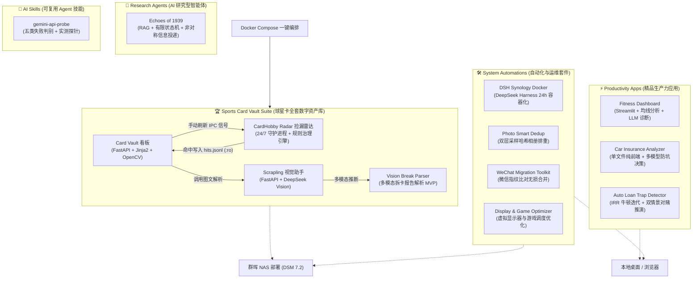

# 🚀 AI Workbench: Personal Creations & Automation Suite
### AI 辅助全栈工程作品合辑 · 数字资产管理 · 个人效率与系统自动化

<p align="center">
  
  
  
  
  
</p>

---

## 📖 项目简介 (Overview)

本仓库是我近期在 **AI 深度协作（Antigravity、WorkBuddy、Gemini 等）** 下打造的个人作品、自建家庭服务与效率工程合辑。

项目涵盖从 **全套数字资产管理（球星卡收藏大屏、OpenCV 居中度检测、24/7 交易市场智能捡漏雷达）** 到 **个人健康体测分析智能体**、**纯前端 AI 决策比对工具**、**金融数学反套路计算器**、**计算音乐学 RAG 智能体**，以及 **群晖 NAS / Windows 自动化运维套件**。

> 📦 本仓库同时收纳了原先散落的两个独立项目：[Auto-Loan-Trap-Detector](https://github.com/GroguZhang/Auto-Loan-Trap-Detector)（车贷 IRR 反套路）与 [Echoes-of-1939](https://github.com/GroguZhang/Echoes-of-1939)（黄河大合唱 RAG 智能体），统一以 Monorepo 形态维护。所有代码均已通过 100% 严格脱敏审计，内置 Mock 数据库与样例配置，支持开箱即用体验。

---

## 🏛️ 系统架构 (Architecture)



---

## 📂 仓库目录导航 (Repository Directory)

### 1. [🏆 sports-card-vault](./sports-card-vault/) · 体育球星卡全套数字资产库
- **[card-vault](./sports-card-vault/card-vault/)**：
  - 基于 FastAPI + OpenCV 开发的数字资产大屏看板；
  - 支持交互式两点拉正、定框裁切与 **Centering 居中度自动测量（预评级分档）**；
  - 资产走势图表与多维度检索，自带开箱即用的 `cards.mock.db`。
- **[cardhobby-radar](./sports-card-vault/cardhobby-radar/)**：
  - 卡淘 24 小时高并发捡漏监控守护进程（约 4000+ 行）；
  - 内置**抗假编/假尾编正则引擎、同名球员消歧治理**与多档位触发逻辑；
  - 支持 PushPlus、Bark、企业微信机器人告警。
- **[scrapling-assistant](./sports-card-vault/scrapling-assistant/)**：
  - 驱动 DeepSeek 视觉模型解析卡片实拍图、提取版型与编数的微服务。
- **[vision-break-parser](./sports-card-vault/vision-break-parser/)**：
  - 国内拼盒/拆卡平台（HobbyStock、麦兜兜等）实拍报告截图 AI 解析器 MVP 与全套精修 Prompt。
- **[docs](./sports-card-vault/docs/)**：
  - 《球星卡私人助手-技术说明》：沉淀 12 个章节的高质量架构设计、10 个防坑设计决策与技术交接规范。

### 2. [⚡ productivity-apps](./productivity-apps/) · 生产力与健康应用
- **[fitness-dashboard](./productivity-apps/fitness-dashboard/)**：
  - 基于 Streamlit 构建的本地健身与体测数据分析看板；
  - 苹果健康 / 训记 Open API 数据同步、7 日移动均线趋势分析、LLM 深度诊断智能体。
- **[car-insurance-analyzer](./productivity-apps/car-insurance-analyzer/)**：
  - 纯前端单文件（TailwindCSS + Marked.js + html2canvas）车险比对决策工具；
  - 支持多模型 AI 自动体检、防坑分析与比对海报长图一键导出。
- **[auto-loan-trap-detector](./productivity-apps/auto-loan-trap-detector/)**：
  - 车贷金融防坑验谎仪：纯现金流 + **牛顿迭代求解 IRR**，还原「等本等息」伪装下的真实年化；
  - 针对「长贷短还 / 贴息对赌」做**双情景推演**，分别算出对赌成功与资金断裂两种结局的真实成本。
  - ↳ 原独立仓库 [Auto-Loan-Trap-Detector](https://github.com/GroguZhang/Auto-Loan-Trap-Detector)，已并入本 Monorepo。

### 3. [🎼 research-agents](./research-agents/) · AI 研究型智能体
- **[echoes-of-1939](./research-agents/echoes-of-1939/)**：
  - 《黄河大合唱》计算音乐学 RAG 智能体，以冼星海第一人称对话讲解乐理与历史语境；
  - **非对称信息投递**：Python 工作流把输出拆成给用户看的 `rich_card` 与只给模型看的 `hidden_analysis`，实现苏格拉底式启发教学；
  - **上下文感知有限状态机 Prompt**：用状态锁防止多轮工具空转，讨论态强制静默 RAG 检索。
  - ↳ 原独立仓库 [Echoes-of-1939](https://github.com/GroguZhang/Echoes-of-1939)，已并入本 Monorepo。

### 4. [🛠️ system-automations](./system-automations/) · 系统运维与自动化
- **[dsh-synology-docker](./system-automations/dsh-synology-docker/)**：DeepSeek Harness (`@deepseek-ai/dsh`) 群晖 Container Manager 容器化开箱即用套件。
- **[photo-smart-dedup](./system-automations/photo-smart-dedup/)**：头部+尾部 16KB 采样哈希与完整 MD5 两阶段过滤的极速相册排重工具。
- **[wechat-migration-toolkit](./system-automations/wechat-migration-toolkit/)**：基于文件指纹比对的 Windows 微信跨机无损合并套件。
- **[display-game-optimizer](./system-automations/display-game-optimizer/)**：虚拟显示器启停与竞技游戏调度优化脚本。
- **[audio-spectrum-visualizer](./system-automations/audio-spectrum-visualizer/)**：单文件 Web Audio API 动态音频频谱可视化器。

### 5. [🧠 ai-skills](./ai-skills/) · 可复用 Agent 技能
- **[gemini-api-probe](./ai-skills/gemini-api-probe/)**：
  - 一条命令实测 Gemini API 真实可用性：验活 Key → 拉该 Key 实际可调的模型 → 真实生成探针 → SSE 连通性；
  - 把失败精确分成**五类**：Key 无效 / 模型已下线 / **地域封锁** / 限流过载 / **浏览器端被 CSP 拦截**；
  - 沉淀了「**列得出来 ≠ 调得通**」「503 会成片出现所以要先体检挑模型」「止损阈值必须比兜底模型位置更靠后」等硬教训。

---

## ⚡ 快速开始 (Quickstart)

### 方式 A：Docker Compose 启动球星卡资产全套微服务

```bash
cd sports-card-vault

# 1. 配置环境变量（默认无需修改即可运行 Mock 数据）
cp cardhobby-radar/.env.example cardhobby-radar/.env
cp scrapling-assistant/.env.example scrapling-assistant/.env

# 2. 一键拉起微服务
docker compose up -d

# 3. 访问看板
# Card Vault 看板: http://localhost:8088
# Scrapling 服务:  http://localhost:8091
```

### 方式 B：启动健身仪表盘 (Fitness Dashboard)

```bash
cd productivity-apps/fitness-dashboard
# Windows 双击运行 run.bat 或执行：
streamlit run app.py
```

### 方式 C：使用车险比对决策工具

直接在任意浏览器中打开 `productivity-apps/car-insurance-analyzer/index.html` 即可！

---

## 🔒 安全与脱敏声明 (Security & Privacy)

本代码库已遵循严格的数据脱敏规范：
1. **无真实资产数据**：所有个人藏品图片与真实 SQLite 数据库均已被屏蔽，仓库内仅包含虚拟演示数据（`cards.mock.db`、`watchlist.example.json`）。
2. **无明文密钥**：所有 API Key、PushPlus Token、内部鉴权已提取为环境变量与 `.env.example`。
3. **无局域网私有信息**：所有私有 IP 与路径已标准化为相对路径或环境变量参数。

---

## 📄 开源许可证 (License)

本项目采用 [MIT License](./LICENSE) 开源协议。
