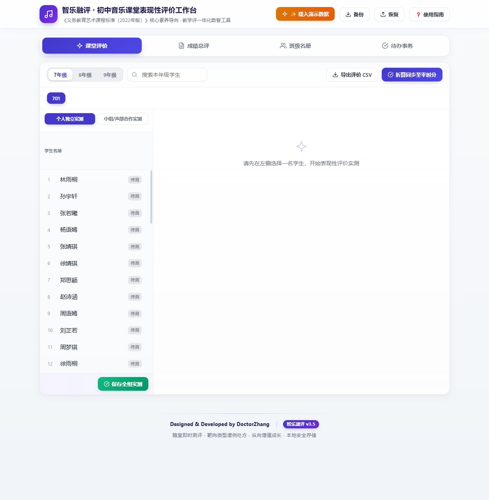
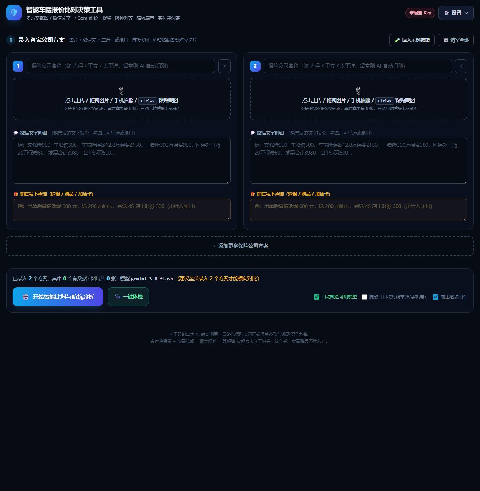
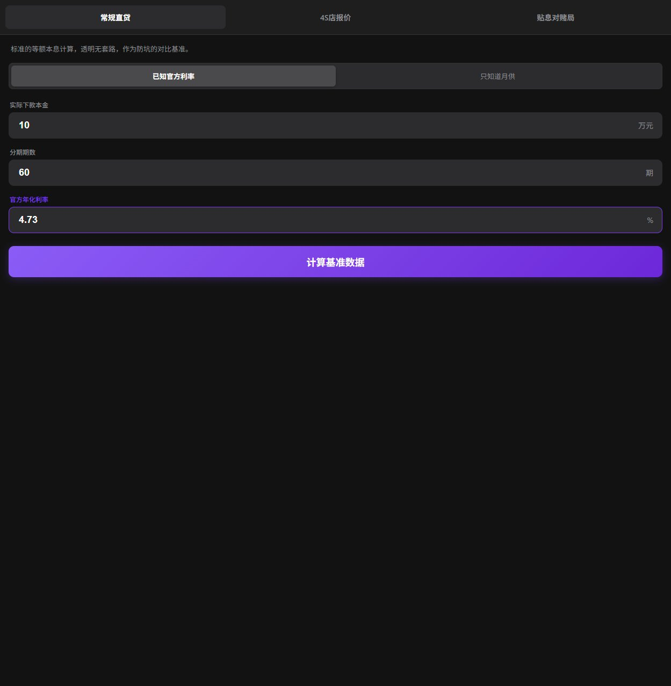
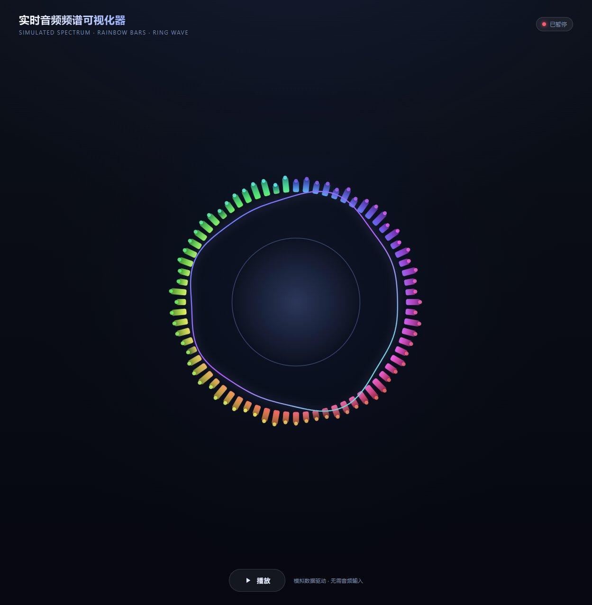
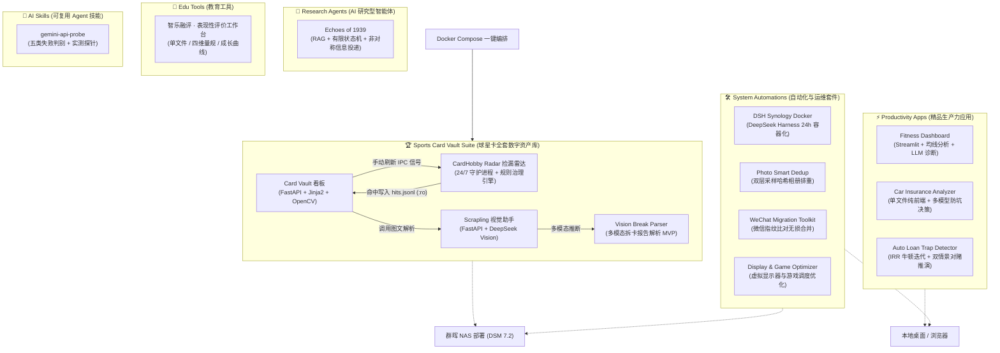

# 🚀 AI Workbench: Personal Creations & Automation Suite
### AI 辅助全栈工程作品合辑 · 数字资产管理 · 个人效率与系统自动化

<p align="center">
  <a href="https://github.com/GroguZhang/ai-workbench/actions/workflows/ci.yml"></a>
  
  
  
  
  
</p>

---

## 📸 界面预览 (Screenshots)

| 智乐融评 · 课堂表现性评价 | 智能车险比对与防坑决策 |
| :---: | :---: |
| [](./edu-tools/zhile-assessment-workbench/) | [](./productivity-apps/car-insurance-analyzer/) |
| **车贷真实利率探测器** | **实时音频频谱可视化器** |
| [](./productivity-apps/auto-loan-trap-detector/) | [](./system-automations/audio-spectrum-visualizer/) |

## 📖 项目简介 (Overview)

本仓库是我近期在 **AI 深度协作（Antigravity、WorkBuddy、Gemini 等）** 下打造的个人作品、自建家庭服务与效率工程合辑。

项目涵盖从 **全套数字资产管理（球星卡收藏大屏、OpenCV 居中度检测、24/7 交易市场智能捡漏雷达）** 到 **个人健康体测分析智能体**、**纯前端 AI 决策比对工具**、**金融数学反套路计算器**、**计算音乐学 RAG 智能体**、**初中音乐课堂表现性评价工作台**，以及 **群晖 NAS / Windows 自动化运维套件**。

> 📦 本仓库同时收纳了原先散落的两个独立项目：[Auto-Loan-Trap-Detector](https://github.com/GroguZhang/Auto-Loan-Trap-Detector)（车贷 IRR 反套路）与 [Echoes-of-1939](https://github.com/GroguZhang/Echoes-of-1939)（黄河大合唱 RAG 智能体），统一以 Monorepo 形态维护。所有代码均已通过 100% 严格脱敏审计，内置 Mock 数据库与样例配置，支持开箱即用体验。

---

## 🏛️ 系统架构 (Architecture)



---

## 📂 仓库目录导航 (Repository Directory)

### 1. [🏆 sports-card-vault](./sports-card-vault/) · 体育球星卡全套数字资产库
- **[card-vault](./sports-card-vault/card-vault/)**：
  - 基于 FastAPI + OpenCV 开发的数字资产大屏看板；
  - 支持交互式两点拉正、定框裁切与 **Centering 居中度自动测量（预评级分档）**；
  - 资产走势图表与多维度检索，自带开箱即用的 `cards.mock.db`。
- **[cardhobby-radar](./sports-card-vault/cardhobby-radar/)**：
  - 卡淘 24 小时高并发捡漏监控守护进程（约 4000+ 行）；
  - 内置**抗假编/假尾编正则引擎、同名球员消歧治理**与多档位触发逻辑；
  - 支持 PushPlus、Bark、企业微信机器人告警。
- **[scrapling-assistant](./sports-card-vault/scrapling-assistant/)**：
  - 驱动 DeepSeek 视觉模型解析卡片实拍图、提取版型与编数的微服务。
- **[vision-break-parser](./sports-card-vault/vision-break-parser/)**：
  - 国内拼盒/拆卡平台（HobbyStock、麦兜兜等）实拍报告截图 AI 解析器 MVP 与全套精修 Prompt。
- **[docs](./sports-card-vault/docs/)**：
  - 《球星卡私人助手-技术说明》：沉淀 12 个章节的高质量架构设计、10 个防坑设计决策与技术交接规范。

### 2. [⚡ productivity-apps](./productivity-apps/) · 生产力与健康应用
- **[fitness-dashboard](./productivity-apps/fitness-dashboard/)**：
  - 基于 Streamlit 构建的本地健身与体测数据分析看板；
  - 苹果健康 / 训记 Open API 数据同步、7 日移动均线趋势分析、LLM 深度诊断智能体。
- **[car-insurance-analyzer](./productivity-apps/car-insurance-analyzer/)**：
  - 纯前端单文件（TailwindCSS + Marked.js + html2canvas）车险比对决策工具；
  - 支持多模型 AI 自动体检、防坑分析与比对海报长图一键导出。
- **[auto-loan-trap-detector](./productivity-apps/auto-loan-trap-detector/)**：
  - 车贷金融防坑验谎仪：纯现金流 + **牛顿迭代求解 IRR**，还原「等本等息」伪装下的真实年化；
  - 针对「长贷短还 / 贴息对赌」做**双情景推演**，分别算出对赌成功与资金断裂两种结局的真实成本。
  - ↳ 原独立仓库 [Auto-Loan-Trap-Detector](https://github.com/GroguZhang/Auto-Loan-Trap-Detector)，已并入本 Monorepo。

### 3. [🏫 edu-tools](./edu-tools/) · 教育工具
- **[zhile-assessment-workbench](./edu-tools/zhile-assessment-workbench/)**：
  - 智乐融评 · 初中音乐课堂表现性评价工作台，**228KB 单文件 HTML**，免安装 / 免联网 / 无需账号；
  - 依据 2022 版艺术课标，把「审美感知 / 艺术表现 / 创意实践 / 文化理解」四维素养落到每节课可留痕的评价；
  - **个人实测与小组·声部合作实测分离**（合唱合奏不拆人头分）、**看发展曲线而非单次分数**、素养诊断小票闭环到课后；
  - 数据只存浏览器本地、一键备份导出，内置 45 人虚拟名单，不含真实学生信息。

### 4. [🎼 research-agents](./research-agents/) · AI 研究型智能体
- **[echoes-of-1939](./research-agents/echoes-of-1939/)**：
  - 《黄河大合唱》计算音乐学 RAG 智能体，以冼星海第一人称对话讲解乐理与历史语境；
  - **非对称信息投递**：Python 工作流把输出拆成给用户看的 `rich_card` 与只给模型看的 `hidden_analysis`，实现苏格拉底式启发教学；
  - **上下文感知有限状态机 Prompt**：用状态锁防止多轮工具空转，讨论态强制静默 RAG 检索。
  - ↳ 原独立仓库 [Echoes-of-1939](https://github.com/GroguZhang/Echoes-of-1939)，已并入本 Monorepo。

### 5. [🛠️ system-automations](./system-automations/) · 系统运维与自动化
- **[dsh-synology-docker](./system-automations/dsh-synology-docker/)**：DeepSeek Harness (`@deepseek-ai/dsh`) 群晖 Container Manager 容器化开箱即用套件。
- **[photo-smart-dedup](./system-automations/photo-smart-dedup/)**：头部+尾部 16KB 采样哈希与完整 MD5 两阶段过滤的极速相册排重工具。
- **[wechat-migration-toolkit](./system-automations/wechat-migration-toolkit/)**：基于文件指纹比对的 Windows 微信跨机无损合并套件。
- **[display-game-optimizer](./system-automations/display-game-optimizer/)**：虚拟显示器启停与竞技游戏调度优化脚本。
- **[audio-spectrum-visualizer](./system-automations/audio-spectrum-visualizer/)**：单文件 Web Audio API 动态音频频谱可视化器。
- **[openwrt-runbook](./system-automations/openwrt-runbook/)**：OpenWrt / Kwrt 远程运维手册 —— 按症状索引的路由器抢修路径（固件升级后全屋断网、软件源报错三个真凶、OpenClash 内核与启用故障、新 opkg 自建本地源、overlay 空间治理）。

### 6. [🧠 ai-skills](./ai-skills/) · 可复用 Agent 技能
- **[gemini-api-probe](./ai-skills/gemini-api-probe/)**：
  - 一条命令实测 Gemini API 真实可用性：验活 Key → 拉该 Key 实际可调的模型 → 真实生成探针 → SSE 连通性；
  - 把失败精确分成**五类**：Key 无效 / 模型已下线 / **地域封锁** / 限流过载 / **浏览器端被 CSP 拦截**；
  - 沉淀了「**列得出来 ≠ 调得通**」「503 会成片出现所以要先体检挑模型」「止损阈值必须比兜底模型位置更靠后」等硬教训。
- **[publication-scan-ocr](./ai-skills/publication-scan-ocr/)**：扫描出版物 → 可搜索 PDF + 页码索引 + 教研派生件（214 行方法论 + 11 个脚本）。
  - 隐藏文字层用 `render_mode=3` + `china-s` 字体，画质无损、体积仅增 1–2%；
  - 揪出 `insert_pdf` 拆散共享图像对象导致**体积翻倍**的坑（必须 `garbage=4`）；
  - 实测标定 OCR 速度 **2.7 s/页**、瘦身最佳点 **200 dpi + JPEG q80 ≈ 396 KB/页**；
  - 记录「OCR 错字稳定复现、重跑无效，只能渲染原页读图抄录」的校正铁律。
- **[music-courseware-standard](./ai-skills/music-courseware-standard/)**：音乐课堂课件生成规范（学生向极简页面 + 教师向演讲者备注的双轨制）。
  - 第一性判断：**这一行字，屏幕前的学生看得懂、且需要看吗？** 不需要就搬进备注；
  - 量化门槛：标题 ≥ 32pt / 正文 ≥ 24pt / 文字覆盖 ≤ 30% / 一页正文 ≤ 40 字；
  - 学唱环节强制四拆（练声 / 单句谱例 / 动作支架 / 变声期关怀），力度做阶梯图不用表格；
  - 附 `inject_notes.py` 二次注入备注的完整修复思路（多数 PPT 生成链路只写替代文字，备注窗格读不到）。

### 7. [📝 docs](./docs/) · 工程随笔
- **[ENGINEERING_LESSONS.md](./docs/ENGINEERING_LESSONS.md)**：三个真实事故的完整复盘 ——
  - 清理脚本越界导致误删，以及 **Agent 被质疑时先辩护、后查证** 的二次伤害；
  - **沙箱写入覆盖层带来的 System+Hidden+ReadOnly 属性**，让文件在资源管理器里「凭空消失」的诊断与恢复，附三条 ACL 强制规范；
  - CSP 误判被实测推翻 → 把「来源启发式」换成「实测探针」；以及**止损阈值必须比兜底项位置更靠后**的自动选模型陷阱。

---

## ⚡ 快速开始 (Quickstart)

### 方式 A：Docker Compose 启动球星卡资产全套微服务

```bash
cd sports-card-vault

# 1. 配置环境变量（默认无需修改即可运行 Mock 数据）
cp cardhobby-radar/.env.example cardhobby-radar/.env
cp scrapling-assistant/.env.example scrapling-assistant/.env

# 2. 一键拉起微服务
docker compose up -d

# 3. 访问看板
# Card Vault 看板: http://localhost:8088
# Scrapling 服务:  http://localhost:8091
```

### 方式 B：启动健身仪表盘 (Fitness Dashboard)

```bash
cd productivity-apps/fitness-dashboard
# Windows 双击运行 run.bat 或执行：
streamlit run app.py
```

### 方式 C：使用车险比对决策工具

直接在任意浏览器中打开 `productivity-apps/car-insurance-analyzer/index.html` 即可！

---

## 🔒 安全与脱敏声明 (Security & Privacy)

本代码库已遵循严格的数据脱敏规范：
1. **无真实资产数据**：所有个人藏品图片与真实 SQLite 数据库均已被屏蔽，仓库内仅包含虚拟演示数据（`cards.mock.db`、`watchlist.example.json`）。
2. **无明文密钥**：所有 API Key、PushPlus Token、内部鉴权已提取为环境变量与 `.env.example`。
3. **无局域网私有信息**：所有私有 IP 与路径已标准化为相对路径或环境变量参数。

---

## 📄 开源许可证 (License)

本项目采用 [MIT License](./LICENSE) 开源协议。

## 🧪 测试与质量保障

本仓库不做「演示型测试」。每个断言都对应一个**踩过的坑**或一个**不能让错的判断**。

### 测试规模：205 个用例 / 6 套

| 套件 | 数量 | 钉住什么 |
| :--- | ---: | :--- |
| `sports-card-vault/card-vault` | 65 | HTTP 契约（增删查生命周期、过滤、错误路径、响应信封）+ 搜索词生成 + 图像几何 + `/healthz` + **透视拉正端到端** + **居中度预评级** + **500 必须返回 JSON** |
| `sports-card-vault/cardhobby-radar` | 81 | 限量编识别（假编/评级分/日期/卡号不得冒充编）、球员名消歧、评级乘数、卡品判定、竞争烈度、**状态文件原子写**、**词库校验**、**封顶可见性** |
| `sports-card-vault/vision-break-parser` | 23 | 模型输出清洗（纯 JSON / 围栏 / 夹带自然语言）、MIME 与 Base64 |
| `sports-card-vault/scrapling-assistant` | 12 | `clean_fence`、`/health`、上游异常映射为 502 |
| `productivity-apps/fitness-dashboard` | 16 | 居中移动平均、趋势斜率、训练容量、BIA 水分连锁误差 |
| `productivity-apps/auto-loan-trap-detector` | 8 | IRR 收敛性自洽、负利率夹取、等额本息公式、输入合理性拦截 |

### 一次跑完

```bash
for d in \
  sports-card-vault/card-vault \
  sports-card-vault/cardhobby-radar \
  sports-card-vault/vision-break-parser \
  sports-card-vault/scrapling-assistant \
  productivity-apps/fitness-dashboard; do
  (cd "$d" && python -m pytest)
done

node productivity-apps/auto-loan-trap-detector/tests/calc.test.js
```

### 三道额外防线

| 防线 | 作用 |
| :--- | :--- |
| `docker-build` job | 真实构建镜像 + 启动容器探活 `/healthz`，Dockerfile 改动无法蒙混过关 |
| `scripts/check_infra.py` | compose 端口冲突 / restart 缺失 / 字面量密钥 / env_file 失效 |
| `secret-guard` job | 真实密钥模式扫描，配合 GitHub Push Protection 双保险 |

### 一个诚实的说明

`car-insurance-analyzer` 与 `edu-tools` 这两个单文件应用**目前没有测试**。
原因是它们的主脚本包在 IIFE 里，函数不暴露到全局，要么改结构、要么用正则抠出一份副本再测——
后者测的是复制品而不是真实代码，没有意义。所以宁可留白，也不做假覆盖。

（`auto-loan-trap-detector` 之所以能测，是因为它的函数是顶层声明，可以在最小 DOM 桩里直接调用真实实现。）

---

## 🤝 贡献与安全

- 想报 Bug 或补测试？先看 [CONTRIBUTING.md](./CONTRIBUTING.md)（说明什么受欢迎、什么不会被合入）。
- 发现凭据泄露？**请勿开公开 issue**，按 [SECURITY.md](./SECURITY.md) 走私有上报通道——先吊销凭据、再清理历史。
- 依赖升级由 Dependabot 每月提 PR，**只提不合**：本项目大量依赖刻意锁定上限，合并前需要先在干净环境验一遍。
