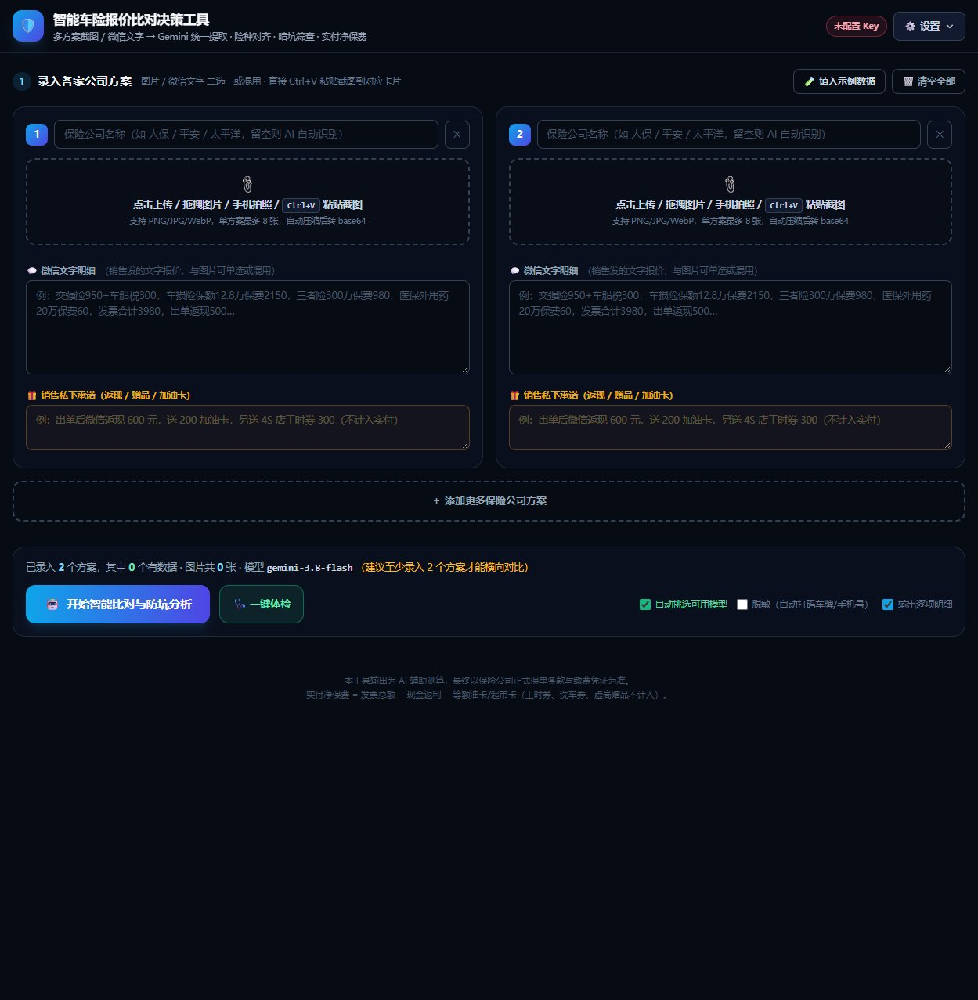

# 智能车险报价比对与防坑决策工具 (Car Insurance Analyzer)

> 一款优雅、零后端依赖的单文件纯前端应用。
> 结合 **多模型 AI（DeepSeek / OpenAI 兼容接口）** 与 **自动化报价解析比对引擎**，帮助车主在各家保险公司繁杂的报价方案中实现智能避坑、保额对齐与性价比最优决策。

## 🌟 核心特性

- **多方案并排横向比对**：支持任意添加 2~5 家保险公司（人保、平安、太平洋等）的报价详情，保费、险种一目了然。
- **🤖 AI 智能防坑与核保诊断**：
  - 自动识别隐形免赔额、过低三者险、非必要附加险等套路；
  - 精准计算各方案相比行业最优的潜在溢价与省钱空间；
  - 自动生成结构化的 Markdown 诊断建议与话术指南。
- **🩺 一键模型体检与自动选型**：内置 API 连通性测试与模型体检功能，自动识别当前响应延迟最优的模型。
- **📸 报告长图一键导出**：基于 `html2canvas` 实现免安装客户端的一键高保真对比海报生成与保存。
- **🧪 开箱即用**：内置「填入示例数据」，零配置即可体验全套比对与分析流程。

## 🚀 使用方法

双击直接在任意现代浏览器中打开 `index.html` 即可运行！
